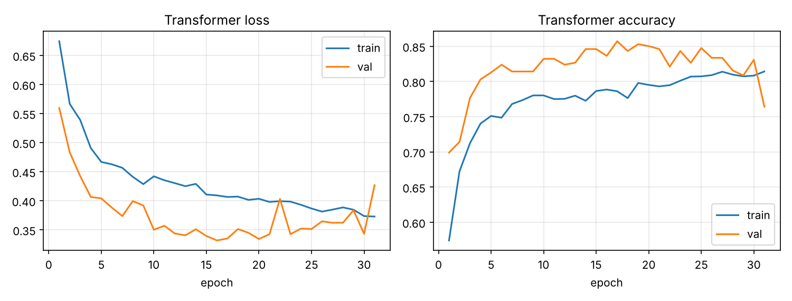
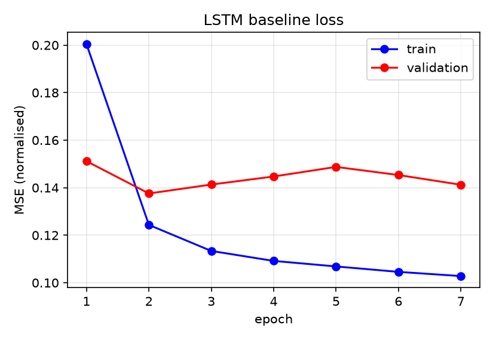
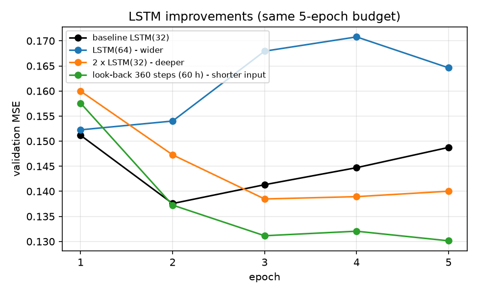

# Time-Series Modelling Benchmark: Transformer Classification (FordA) and LSTM Forecasting (Jena Climate)

This repo reproduces two official Keras time-series examples that are organized and benchmarked. The LSTM forecaster is improved with three controlled changes.

## 1. Problem setup
| | Classification | Forecasting |
|---|---|---|
| Dataset | FordA (UCR archive): engine sensor, 3,601 train / 1,320 test series, 500 steps each, 1 channel | Jena Climate 2009-2016: 420,551 rows (every 10 min), 14 weather features, 7 selected |
| Task | Binary label: is a fault present? | Regression: temperature 12 h (72 steps) ahead |
| Input | `(batch, 500, 1)` | `(batch, 120, 7)`: past 120 h sampled hourly, z-scored with training statistics |
| Output | Softmax over 2 classes | One real number (normalised temperature) |
| Model | Transformer encoder: Conv1D input projection, 4 x [multi-head self-attention + residual + LayerNorm + Conv1D feed-forward], global average pooling, MLP head | One LSTM layer (32 units) + Dense(1) |
| Loss / metric | Sparse categorical cross-entropy / accuracy | MSE (normalised) / MAE and RMSE in degC |

**Classification vs forecasting.** Classification maps a whole series to one discrete label and may look at all time steps at once. Forecasting predicts future values, so it must respect time order: the split is chronological and the label is always in the future of the input window.
**Transformer vs LSTM.** An LSTM reads steps one at a time and carries a hidden state, so cost grows linearly with length but it is sequential. Self-attention lets every step look at every other step in parallel (cost grows quadratically with length), which captures long-range patterns but needs more memory and compute.

## 2. How to run
```bash
pip install tensorflow keras pandas matplotlib

# LSTM forecasting (Jena Climate)
python src/lstm_jena.py --name baseline
python src/lstm_jena.py --name hidden64 --hidden 64 --epochs 5
python src/lstm_jena.py --name stack2   --lstm_layers 2 --epochs 5
python src/lstm_jena.py --name past360  --past 360 --epochs 5

# Transformer classification (FordA)
python src/transformer_forda.py --name baseline --epochs 60 --patience 15 --lr 3e-4 --batch 32 --d_model 64 --embed_kernel 7 --dropout 0.1 --mlp_dropout 0.2 --prenorm 1
python src/transformer_forda.py --name wide_ff --epochs 60 --patience 15 --lr 3e-4 --batch 32 --d_model 64 --embed_kernel 7 --dropout 0.1 --mlp_dropout 0.2 --prenorm 1 --ff_dim 128
```

## 3. Task I - Baselines
| Model | Params | Epochs run | Train acc | Val acc | Test acc | Time/epoch |
|---|---|---|---|---|---|---|
| Transformer (FordA) | 1,073,554 | 31 (best 16) | 0.789 | 0.836 | **0.816** | 22 s |

Run as the official Keras example with three changes needed to make it train (see section 3b): a Conv1D(64, kernel 7) input projection, layer norm applied before attention and feed-forward (pre-norm), and Adam 3e-4. Dropout is 0.1 and MLP dropout 0.2 (official: 0.25 and 0.4), batch 32 (official: 64), up to 60 epochs with early stopping (patience 15, best weights restored); 31 epochs ran. Test accuracy is **0.816** with 1,073,554 parameters (official write-up: about 0.85 after 150 epochs). Train/val accuracy in the table are taken at the epoch with the lowest validation loss, which is the epoch whose weights the test score uses. Training accuracy (0.789) sits below validation accuracy because dropout is active during training only and the validation split is small (720 series).



**LSTM baseline (Jena).** Official settings: LSTM(32), Adam 1e-3, batch 256, up to 10 epochs, early stopping patience 5. Best validation MSE 0.1376 = 2.51 degC MAE / 3.20 degC RMSE (5,153 parameters, 7 epochs run, best epoch 2).



## 3b. Getting the Transformer to train
The unmodified Keras example sat at chance level here: loss 0.693 (= ln 2) and 0.510 validation accuracy (the share of the majority class in the validation split) for the whole run. Several runs were needed to find out why. All of them are kept in `results/`.

| Setting | Epochs run | Val acc | Test acc |
|---|---|---|---|
| official block, raw 1-feature input, lr 1e-4, batch 32 | 29 | 0.510 | 0.516 |
| + Conv1D projection to 64 features, kernel 1, lr 1e-4 | 25 | 0.510 | 0.516 |
| projection kernel 7, post-norm (official block), lr 1e-3, 12 epochs | 12 | 0.577 | 0.552 |
| projection kernel 7, pre-norm, lr 1e-3, 12 epochs | 12 | 0.817 | 0.779 |
| projection kernel 7, pre-norm, lr 3e-4, 12 epochs | 12 | 0.846 | 0.833 |

Diagnosis:
1. **Layer norm on a 1-feature input outputs zero.** FordA has one value per time step, so `LayerNormalization` over the feature axis normalises a single number: (x - mean) is exactly 0. Checked directly: it returns all zeros. Attention and feed-forward outputs therefore collapse to constants and only the residual path carries the raw series. Each series is already z-scored (mean about 0), so averaging over time leaves nothing to classify. Fix: project the input to 64 features first (`--d_model 64`).
2. **A per-step projection still cannot see the shape of the waveform.** With kernel size 1 every step is embedded on its own, and attention, the feed-forward layers and the global average pooling that follow all ignore step order, so the model sees only a histogram of values. The test accuracy stayed at 0.516. On a small convolution-only model we checked separately, kernel size 1 gave 0.515 and kernel size 7 gave 0.719 test accuracy (an extra check, not saved in `results/`). Fix: kernel size 7 (`--embed_kernel 7`), so each feature covers 7 neighbouring steps.
3. **Optimisation.** With kernel 7 the official post-norm block with lr 1e-3 only began to learn in the last epochs of a 12-epoch run (validation accuracy 0.577). Pre-norm (layer norm before attention and feed-forward) at lr 3e-4 trained steadily to 0.846 validation and 0.833 test accuracy in 12 epochs, so it was chosen for the baseline.

## 4. Task II - Improvements (LSTM forecaster, three modifications)
Each change is made one at a time on top of the baseline; seed, data, optimiser, learning rate and batch size are identical. All variants and the baseline are compared at the same 5-epoch budget (the baseline row uses its best validation MSE within its first 5 epochs).

| Variant | Params | Hidden x layers | Look-back (h) | Train MSE | Val MSE | Val MAE (degC) | Val RMSE (degC) |
|---|---|---|---|---|---|---|---|
| **baseline** LSTM(32) | 5,153 | 32 x 1 | 120 | 0.1243 | 0.1376 | 2.51 | 3.20 |
| LSTM(64) - wider | 18,497 | 64 x 1 | 120 | 0.1716 | 0.1523 | 2.62 | 3.37 |
| 2 x LSTM(32) - deeper | 13,473 | 32 x 2 | 120 | 0.1208 | 0.1385 | 2.52 | 3.21 |
| look-back 360 steps (60 h) - shorter input | 5,153 | 32 x 1 | 60 | 0.1090 | 0.1301 | 2.43 | 3.12 |

The baseline reaches its best validation MSE of 0.1376 (about 2.51 degC mean absolute error for a 12-hour-ahead forecast) at epoch 2. After that, training loss keeps falling to 0.1028 while validation loss rises to 0.1412: the model starts to overfit the training period (the first 71.5% of the record), so early stopping is doing real work.
- **LSTM(64) - wider**: val MSE 0.1523 vs 0.1376 (+10.7%), MAE 2.62 degC, 18,497 params.
- **2 x LSTM(32) - deeper**: val MSE 0.1385 vs 0.1376 (+0.7%), MAE 2.52 degC, 13,473 params.
- **look-back 360 steps (60 h) - shorter input**: val MSE 0.1301 vs 0.1376 (-5.4%), MAE 2.43 degC, 5,153 params.



**What was learned.** The best change was **look-back 360 steps (60 h) - shorter input** (-5.4% validation MSE versus the baseline at the same 5-epoch budget). Widening to 64 units gave +10.7% (worse) with 3.6x the parameters: its training loss kept falling (0.1716 to 0.1086) while validation loss rose from 0.1523 to 0.1646 over the 5 epochs, i.e. extra capacity overfits instead of helping. Stacking a second LSTM layer gave +0.7% (worse) for 2.6x the parameters, so depth did not improve the best score at this data size, although its validation curve stays flatter than the baseline's, which rises after epoch 2 (epoch-5 val MSE 0.1400 vs 0.1488). Shortening the look-back from 120 h to 60 h gave -5.4% (better) while halving the sequence length: for a 12-hour-ahead forecast the older half of the window adds noise more than signal, and a shorter input is also cheaper. So for this task the input window and regularisation matter more than model size.

## 5. Task III - Benchmark
| Model | Task | Params | Headline result |
|---|---|---|---|
| Transformer | FordA classification | 1,073,554 | test accuracy 0.816 |
| Transformer, wider feed-forward | FordA classification | 1,137,538 | test accuracy 0.813 |
| LSTM baseline | Jena 12 h forecast | 5,153 | val MAE 2.51 degC |
| LSTM(64) - wider | Jena 12 h forecast | 18,497 | val MAE 2.62 degC |
| 2 x LSTM(32) - deeper | Jena 12 h forecast | 13,473 | val MAE 2.52 degC |
| look-back 360 steps (60 h) - shorter input | Jena 12 h forecast | 5,153 | val MAE 2.43 degC |

## 6. Task IV - Questions
**Which model did you find easier to understand and why?** LSTM. Data flow through the network is one such concept: go through time steps, update a hidden state, predict based on the last hidden state; the Keras implementation takes only five lines of code. On the other hand, the Transformer requires several concepts to be applied together (query/key/value, multi-head attention, residual connections, LayerNorm, Conv1D as a position-wise dense layer, pooling), and lacks any inherent sense of order, hence the difficulty to understand its behaviour and hyper-parameters (number of heads, their size, number of blocks). Training the Transformer (section 3b) took several attempts, while the LSTM was trained successfully in the very first attempt.

**What improvement did you try, and what did you learn from it?** Three variations were performed on the LSTM predictor: increase the number of units, stack a second layer on top of the first, and decrease the look-back length. The best variation turned out to be **look-back 360 steps (60 h) - shorter input** (-5.4% validation MSE with respect to the baseline within the same 5-epoch budget). Widening to 64 units yielded +10.7% (bad result) and 3.6x parameters: training loss of this version decreased from 0.1716 to 0.1086 whereas validation loss increased from 0.1523 to 0.1646 during the 5 epochs. So the increased capacity overfits instead of being helpful. Adding another LSTM layer to the architecture resulted in +0.7% (bad result) with 2.6x parameters: depth did not lead to improvement of the best score on this size of data although its validation curve is flat compared to that of the baseline (which rises after epoch 2), epoch-5 validation MSE of which is 0.1400 versus 0.1488. Reducing the look-back length from 120 h to 60 h led to -5.4% (good result) despite halving the length of the sequence: the older half of the window adds noise rather than useful information for a 12-hour forecast. The takeaway from the experiment is that the starting point is close to the point where validation error plateaus after two epochs of training, hence the gains are coming from variance reduction and input sequence length limitation.
